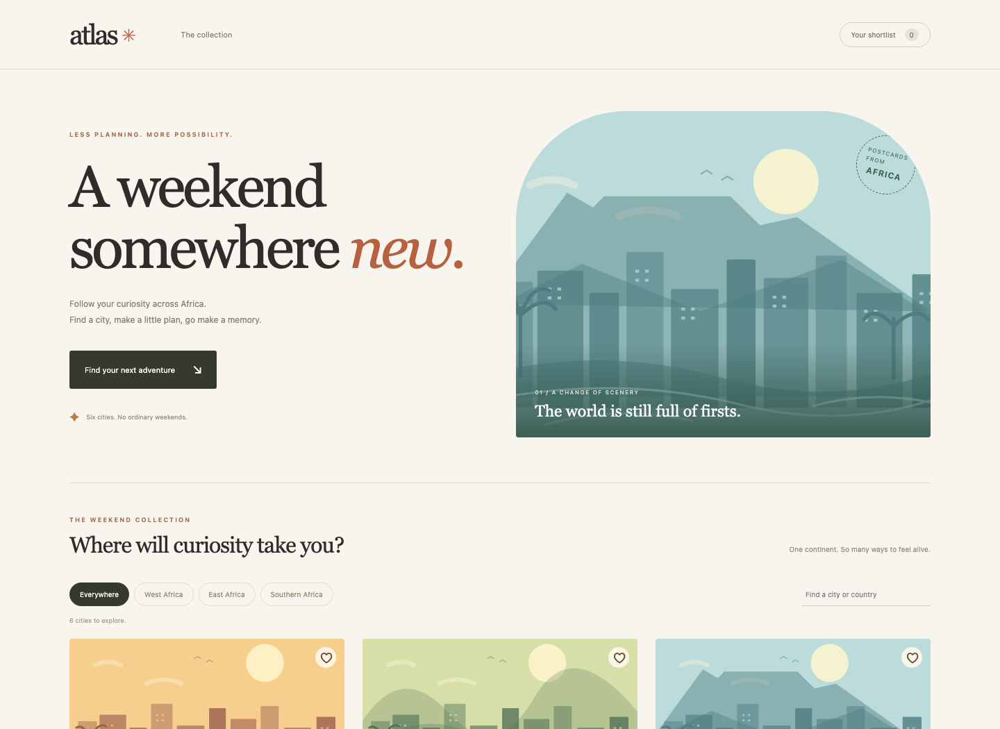

# Atlas — Next.js weekend explorer

[](https://github.com/SimplifydCloud/sample-nextjs-atlas/actions/workflows/ci.yml)

Six African cities. A thousand possible weekends. An editorial city explorer with original SVG illustrations, country search, region filters, saved shortlists, a selectable itinerary, live budget totals, and downloadable day plans.

Built with **Next.js App Router**, React, server components, statically generated dynamic routes, route metadata, and client components for interactive features. No API keys, external image services, or database required.



## Try it locally

Click **Use this template → Create a new repository**, or:

```sh
git clone https://github.com/SimplifydCloud/sample-nextjs-atlas.git
cd sample-nextjs-atlas
npm ci
npm run dev
```

Requires **Node 22.12+**. Open the URL printed by Next.js. Save a city, open its page, deselect an activity, and download your plan. Shortlists and itineraries persist in the current browser and origin.

All activities and USD budgets are **fictional demo content**, not travel recommendations or live prices. No booking or payment takes place.

## Deploy on Simplifyd Cloud

1. Create your own repository from this template.
2. In a Simplifyd project, choose **Add → Static Site**, then apply.
3. Open **Settings → Build → Deploy from GitHub**, connect GitHub, and grant the Simplifyd GitHub App access to your repository.
4. Choose your repository and `main`. Leave the directory at the repository root.
5. Detect Next.js, review the settings below, and build.

| Setting | Value |
| --- | --- |
| Node | `22` |
| Install | `npm ci` |
| Build | `npm run build` |
| Output directory | `out` |
| Index / error document | `index.html` / `404.html` |
| Environment variables | None |

`next.config.mjs` already sets `output: 'export'` and `trailingSlash: true`. The six city pages are generated at build time with `generateStaticParams`, so links such as `/cities/lagos/` work directly. Do not enable SPA fallback: the exported 404 page should handle unknown routes.

Managed GitHub builds must be enabled on your Simplifyd installation. Future pushes publish new releases. Alternatively, zip the **contents** of `out` after `npm run build` and upload them in the static site's Files tab.

### Optional container

```sh
docker build -t atlas .
docker run --rm -p 8080:8080 atlas
```

This serves the same static export on port 8080. Atlas demonstrates static Next.js deployment. Runtime SSR, server actions, and server API routes require a Node compute deployment and are outside this sample's static configuration.

## Checks

```sh
npm run build
npx playwright install chromium
npm test
```

Browser tests cover region and search filters, saved shortlists, direct city links, itinerary persistence, budget recalculation, download, and mobile layout.

## Make it yours

- `lib/cities.js`: destinations, activities, illustrative prices, and copy.
- `app/cities/[slug]/page.jsx`: server-rendered route structure and metadata.
- `components/`: interactive explorer and itinerary builder.
- `public/cities/`: original editable SVG artwork, included under the MIT license.
- `app/style.css`: the editorial design and responsive layout.

[More Simplifyd samples](https://github.com/SimplifydCloud/sample-projects) · [Next.js static export documentation](https://nextjs.org/docs/app/guides/static-exports) · MIT licensed.
